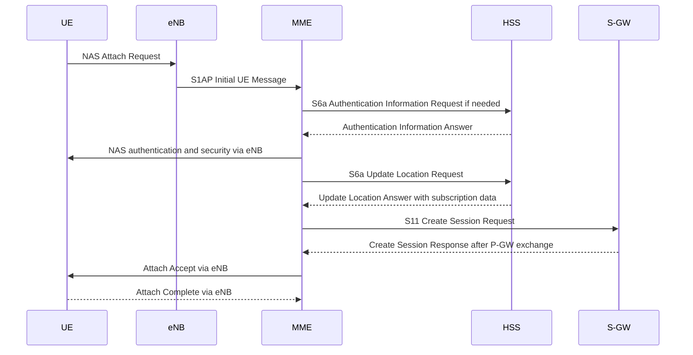

# LTE Core Operations Lab

Two simulated LTE attach attempts time out during S6a authentication. This lab shows how to find that pattern in a batch of attach records and decide which evidence to check on the MME and HSS.

## Quick start

From the repository root, run the [analyzer](triage.py) with Python 3 and the [sample CSV](attempts.csv). No external packages are required.

```sh
python3 triage.py attempts.csv
```

Expected output for the bundled fixture:

```text
Attempts: 10
Attach success: 5/10 (50.0%)
Median successful attach latency: 220 ms
auth_timeout: 2 | s6a_auth | first check: core/authentication
profile_missing: 1 | s6a_location_update | first check: core/subscriber provisioning
session_timeout: 1 | s11_create_session | first check: core/session establishment
transport_timeout: 1 | s1_initial_ue | first check: RAN/transport
```

Each CSV row represents one completed or failed attempt. Supply a unique `attempt_id`, an `outcome`, its matching `stage`, and a non-negative integer `latency_ms`. The analyzer checks stage and outcome against a fixed mapping. It groups records that already have a stage label. The incident walkthrough is where that evidence is interpreted.

| KPI | Calculation | Fixture result |
| --- | --- | --- |
| Attach success | Completed attaches / unique attempts | 5 / 10 (50%) |
| Median attach latency | Median on completed attempts | 220 ms |
| Leading failure category | Highest count among failed attempts | S6a authentication timeout (2 of 5 failures) |

## Trace the attach

This simplified control-plane view covers initial EPS attach. It omits optional steps and detailed bearer signalling.



## Incident walkthrough

Attempts a06 and a07 reached the modeled S6a authentication stage and timed out. Start by comparing MME and HSS transaction IDs and timestamps. Check Diameter peer status, routing and upstream response times before attributing the incident to the HSS. For a08, an explicit missing-profile result warrants checking the test subscriber's service and APN entitlements. For a09, confirm whether the eNodeB sent the Initial UE Message and whether the MME saw it. For a10, look for the S11 response, then check the S-GW to P-GW path.

### Compare a successful attach and a timeout

The [synthetic event trace](attach-events.csv) shows timestamped MME-side events for two attempts in the batch.

| Step | Successful attempt (a01) | Timed-out attempt (a06) | What I’d check |
| --- | --- | --- | --- |
| Last shared step | MME sends Authentication Information Request after 20 ms | MME sends the same request type after 20 ms | Match the exchange ID and compare timestamps across peers |
| First difference | MME records the matching Answer after 45 ms | MME records a timeout after 1,200 ms with no matching Answer in the trace | Check whether the HSS received the request and sent an Answer. If it sent one, check the response path and MME logs |
| Outcome | Attach Complete after 180 ms | No Attach Complete in this trace | After a change, repeat both scenarios and compare the first point where they diverge |

The missing Answer in these MME-side records narrows the investigation to the S6a exchange. HSS-side transaction logs and peer or transport evidence would help identify where the exchange stopped.

After an approved change, repeat a known-good and known-failing test attach, verify the expected stage and KPI trend against a comparable baseline, and record the change, owner, timestamps, evidence and rollback trigger.

## Validation checklist

| Area | Expected evidence |
| --- | --- |
| Provisioning | Allowed test profile attaches to the authorized APN. Missing or mismatched profile follows the expected reject path. |
| Authentication | Valid test credentials complete NAS authentication. Invalid credentials and peer timeouts produce distinct outcomes. |
| Charging | In a separate controlled test, correlate successful bearer use with expected charging records or quota behavior. Verify retries against charging and session identifiers. |
| Roaming and interconnect | In a partner test environment, verify the visited and home network paths, subscriber authorization, selected routing and expected service. Capture the failing interface and result code when a scenario fails. |
| Node rollout | Capture pre-change peer health and KPIs, validate a canary attach, document rollback criteria and compare post-change results. |

The runnable fixture covers attach outcomes. Charging, roaming and rollout entries are test design examples. For 3G UMTS and 2G GSM/GPRS, compare packet-domain SGSN/GGSN flows and use RAT-specific procedures and denominators when comparing KPIs.

Reference: [3GPP TS 23.401 via ETSI, clause 5.3.2.1](https://www.etsi.org/deliver/etsi_ts/123400_123499/123401/17.11.00_60/ts_123401v171100p.pdf).
